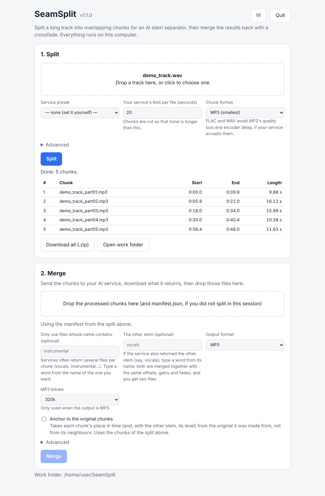

<div align="center">

# SeamSplit

**Split a long song into overlapping chunks for AI stem separators, then merge the results back with a real crossfade instead of a naive concatenation.**

[](https://github.com/ndhn27/seamsplit/actions/workflows/ci.yml)
[](LICENSE)
[](pyproject.toml)
[](https://github.com/psf/black)

Drag-and-drop page · Command line · Runs on your computer · No FFmpeg to install



</div>

## ⚡ Quick start

Python 3.10 or newer. Audio is read and written inside the process by [PyAV](https://pyav.org/), whose wheels carry FFmpeg, so there is no `ffmpeg` to put on your `PATH`.

```bash
git clone https://github.com/ndhn27/seamsplit.git && cd seamsplit
pip install .
seamsplit gui          # opens a page in your browser: drop a track, press Split
```

Send the chunks to your AI separator, drop what it returns on the second card, press *Merge*. Prefer a terminal?

```bash
seamsplit split song.mp3 --limit 59 --out chunks/      # chunks + manifest.json
# run each chunk through your separator and save the results in processed/
seamsplit merge processed/ --manifest chunks/manifest.json --match instrumental --out song_instrumental_full.mp3
```

More: [Installation](docs/installation.md) · [One-file programs](docs/packaging.md) (no Python needed).

## 💡 Why

Browser-based vocal/instrumental separators usually cap an upload at about a minute, so a full song goes through in pieces. Two things decide how the pieces sound once they are back together:

1. **Where you cut.** A cut at a single noisy minimum, rather than in a sustained quiet passage, leaves the model its least stable context on either side, so its output tends to diverge right at that edge.
2. **How you rejoin.** Gluing processed chunks together (`ffmpeg -f concat`) blends nothing: each chunk was processed on its own, so a small difference in level or phase at the boundary is an audible click.

`split` looks for cut points in a smoothed loudness curve, favouring sustained quiet passages, and gives every chunk an overlap into its neighbours. `merge` measures and cancels the timing offset between neighbouring chunks, matches their levels, crossfades across each overlap, and warns about any seam that looks wrong.

## 🔁 How it works

```
song.mp3
   │
   ▼ seamsplit split
chunks/part01.mp3, chunks/part02.mp3, ... + chunks/manifest.json
   │
   ▼ run each chunk through your AI separator (keep the order; renaming is fine)
processed/part01_instrumental.mp3, processed/part02_instrumental.mp3, ...
   │
   ▼ seamsplit merge
song_instrumental_full.mp3
```

Or keep everything in one folder that can be left and picked up again ([Jobs and local separation](docs/jobs-and-backends.md)):

```bash
seamsplit run song.mp3 --service xminus     # split, then wait for the results
seamsplit status song.job                   # which chunks are still missing?
seamsplit run --job song.job                # merge, once they are all there

seamsplit run song.mp3 --backend demucs     # or separate on this computer: no limit, no upload
```

## ✨ Features

- **Smart cuts.** Quiet passages rather than a single noisy minimum; optionally judged by activity in the voice band and snapped to the beat or the bar. Chunks are sized to your service's limit, can be lossless (`flac`/`wav`), and there are presets for known services. → [Splitting a track](docs/splitting.md)
- **A merge that blends.** Timing alignment, level matching, an adaptive crossfade, and a report that flags the seams worth a listen. → [Merging the results](docs/merging.md), [How the merge works](docs/how-the-merge-works.md)
- **Files may come back renamed.** Paired by name, by order, and checked against the original chunks by sound. → [Which file is which chunk](docs/merging.md#which-file-is-which-chunk)
- **Anchoring and a listening kit.** Compare every chunk with the original it was made from, merge both stems together, and listen to the seams on a blind listening page. → [Anchoring and the listening kit](docs/anchoring-and-listening.md)
- **One folder per job.** `run` and `status` resume where you left off, and can separate locally with Demucs or audio-separator. → [Jobs and local separation](docs/jobs-and-backends.md)
- **A drag-and-drop page** (English and Vietnamese) that serves only `127.0.0.1`. → [Drag-and-drop interface](docs/gui.md)

## 📚 Documentation

| Page | What is in it |
| --- | --- |
| [Drag-and-drop interface](docs/gui.md) | The browser page: split, merge, listen; where files go; how it is kept local |
| [Splitting a track](docs/splitting.md) | Every `split` option, choosing where to cut, lossless chunks, service presets |
| [Merging the results](docs/merging.md) | Pairing files with chunks, every `merge` option, the seam report |
| [How the merge works](docs/how-the-merge-works.md) | Timing alignment, level matching, crossfade curves, seam search |
| [Anchoring and the listening kit](docs/anchoring-and-listening.md) | Comparing with the original chunks, both stems, listening to the seams |
| [Jobs and local separation](docs/jobs-and-backends.md) | `run` and `status`, the job folder, Demucs and audio-separator backends |
| [Installation](docs/installation.md) | What gets installed, and why FFmpeg comes with it |
| [One-file programs](docs/packaging.md) | PyInstaller builds for Linux, Windows and macOS |
| [Development](docs/development.md) | Tests, linters, and a map of the modules |
| [Benchmarks](benchmarks/README.md) | Method and numbers, and what they do not show |
| [Contributing](CONTRIBUTING.md) · [Security](SECURITY.md) | How to help; how to report a problem privately |

## 📊 Benchmarks

Measured on five real songs separated by a real model (UVR MDX-Net, on the CPU). Against the same song separated in one go, the signal-to-error ratio at the seams rose from 21.2 dB with no overlap to 25.9 dB with 2 s of overlap; crossfading the overlap beat a hard cut at most seams (not all), by under a dB at the median. Local model, short clips, no listening test: the [benchmark README](benchmarks/README.md) says what the numbers do and do not show, and the results are in [`benchmarks/results/RESULTS.md`](benchmarks/results/RESULTS.md).

## 📄 License

[MIT](LICENSE) © 2026 ndhn27.

PyAV's FFmpeg is built with GPL-licensed libx264 and libx265. SeamSplit uses it only for audio, but a program that bundles those libraries has to follow their licences: see [THIRD_PARTY_NOTICES.md](THIRD_PARTY_NOTICES.md).
